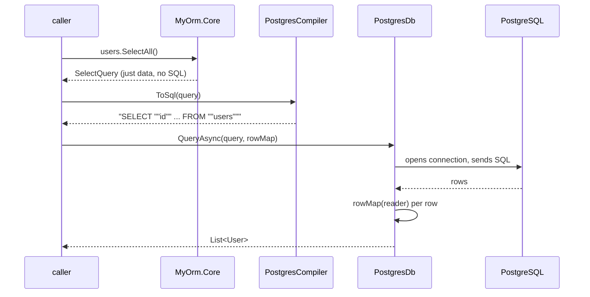

# Basic SELECT — how it works

> Status: initial draft · applies to the `feat: basic PostgreSQL SELECT support` implementation
> (`d31c7ce`)

This document explains the end-to-end path of a basic SELECT query through the
current codebase: what a caller writes, what each layer does, and why the
boundaries are drawn where they are. It doubles as a worked example for
contributors (and future agent tooling) to anchor on.

## The four steps

A SELECT moves through four layers, two compilations, and one side effect:

```
describe → compile → execute → per-row map
```

1. **Describe** (MyOrm.Core) — you build an inert query object.
2. **Compile** (MyOrm.Postgres) — that object becomes an SQL string.
3. **Execute** (MyOrm.Postgres) — the SQL string is sent through Npgsql.
4. **Map** (your code) — each result row becomes a C# object.

Everything happens when you call; a `SelectQuery` is data, nothing asks a
database anything at construction time, and there is no SQL before you compile.



## Step 1 — describe

```csharp
using MyOrm;

var users = new Table("users", "id", "name", "age");
var query = users.SelectAll();
```

```csharp
// src/MyOrm.Core/Table.cs
public Table(string name, params string[] columnNames)
{
    // guarded: table name and every column name must be non-empty
    Name = name;
    Columns = columnNames.Select(c => new Column(c)).ToArray();
}

public SelectQuery SelectAll() => new(this);
```

The constructor stores `Name = "users"` and `Columns =
[Column("id"), Column("name"), Column("age")]`. That is the entire metadata —
only names, no types, which is all an unfiltered SELECT needs.

`users.SelectAll()` does exactly one thing: it creates a `SelectQuery` holding
a reference to this table. Nothing asks a database anything, no SQL exists yet.
It is equivalent to `new SelectQuery(users)`; the method is readable syntax.

```csharp
// src/MyOrm.Core/SelectQuery.cs
public sealed class SelectQuery
{
    public Table Table { get; }
    public SelectQuery(Table table) => Table = table;
}
```

At this point the query is plain data. That is the "SQL generation separate
from execution" split: Core holds queries without knowing what a database is,
and nothing in `MyOrm.Core` references Npgsql.

## Step 2 — compile

```csharp
using MyOrm.Postgres;

var sql = PostgresCompiler.ToSql(query);
// SELECT "id", "name", "age" FROM "users"
```

```csharp
// src/MyOrm.Postgres/PostgresCompiler.cs
public static string ToSql(SelectQuery query)
{
    var columns = string.Join(", ", query.Table.Columns.Select(c => QuoteIdentifier(c.Name)));
    return $"SELECT {columns} FROM {QuoteIdentifier(query.Table.Name)}";
}

internal static string QuoteIdentifier(string identifier) =>
    $"\"{identifier.Replace("\"", "\"\"")}\"";
```

Reading it: take the stored column names, quote each one, join with commas,
prepend `SELECT`, append the quoted table name. `QuoteIdentifier` wraps each
name in double quotes and doubles any embedded `"` (Postgres' escaping rule),
so a table/column literally named `my"table` still produces a valid statement.

The compiler is pure: same input, same output string, no connection involved.
That property is why tests can assert the exact SQL text without a database.

## Step 3 — execute

```csharp
// src/MyOrm.Postgres/PostgresDb.cs
public async Task<IReadOnlyList<T>> QueryAsync<T>(
    SelectQuery query,
    Func<NpgsqlDataReader, T> map,
    CancellationToken cancellationToken = default)
{
    await using var connection = new NpgsqlConnection(_connectionString);
    await connection.OpenAsync(cancellationToken);

    await using var command = new NpgsqlCommand(PostgresCompiler.ToSql(query), connection);
    await using NpgsqlDataReader reader = await command.ExecuteReaderAsync(cancellationToken);

    var rows = new List<T>();
    while (await reader.ReadAsync(cancellationToken))
        rows.Add(map(reader));

    return rows;
}
```

1. `new NpgsqlConnection(_connectionString)` — `PostgresDb` is created once
   with only a connection string; the connection references no shared mutable
   state.
2. `ExecuteReaderAsync` — Npgsql sends the SQL text. The generated query has
   no parameters (only quoted identifiers, no interpolated user data), so
   there is no injection surface for the values that will arrive later.
3. `while (await reader.ReadAsync(...))` — position the cursor on each
   returned row, streaming lazily.
4. **`rows.Add(map(reader))` runs the caller's lambda once per row** — see
   step 4.

All awaiting/IO lives in `PostgresDb`; `MyOrm.Core` stays synchronous and
provider-free, so a second dialect (e.g. SQL Server) would add a new
`MyOrm.MsSql` project with its own compiler/executor, and none of the query
objects or table definitions change.

## Step 4 — map

```csharp
public record User(int Id, string Name, int Age);

var rows = await db.QueryAsync(query, r => new User(
    r.GetInt32(r.GetOrdinal("id")),
    r.GetString(r.GetOrdinal("name")),
    r.GetInt32(r.GetOrdinal("age"))));
```

For each row, `r` is an `NpgsqlDataReader` positioned on it:

- `r.GetOrdinal("id")` asks the result set which column index `id` sits at,
  so mapping is resilient to column reordering,
- `r.GetInt32(...)` reads that column's value (with the correct provider
  type),
- `new User(...)` constructs the record.

The delegate is the caller's explicit mapping contract. There is no reflection
or automatic name matching at this stage — deliberate simplification for the
first milestone; an automatic mapper is the natural third layer once a second
use of `QueryAsync` shows what convention is worth copying.

## Test anchoring

The same flow decomposes into the three places tests live
(`tests/MyOrm.Core.Tests`, `tests/MyOrm.Postgres.Tests`):

- **Describe** — `TableTests`: metadata shape, guards on empty names.
- **Compile** — `PostgresCompilerTests`: exact SQL text, identifier escaping.
- **Execute + map** — `PostgresRoundTripTests`: runs against a live PostgreSQL
  when the `MYORM_CONNECTION_STRING` environment variable is set (the same
  variable `BasicExample` uses), creates/drops only a dedicated
  `myorm_test_users` table, seeds two rows, and asserts the mapped records.

## Running the example

See [`examples/BasicExample/README.md`](../examples/BasicExample/README.md) —
short version:

```sh
export MYORM_CONNECTION_STRING="Host=localhost;Username=postgres;Password=<secret>;Database=myorm"
dotnet run --project examples/BasicExample
```

Without the variable the example still prints the generated SQL and setup
help, then exits.

## Deliberate limits (first milestone)

Not implemented, not hidden: `WHERE`/`JOIN`/`ORDER BY`/`LIMIT`,
`INSERT`/`UPDATE`/`DELETE`, column types/nullability, parameters, transactions,
migrations, typed model generation, and dialects other than PostgreSQL. The
boundaries above (Core data objects / dialect compiler / executor) were chosen
so those additions extend rather than reshape the code.
