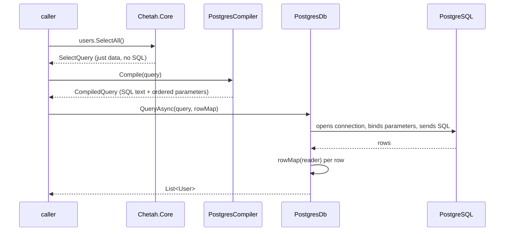

# Basic SELECT — how it works

> Status: updated for Stage 2 · applies to `feat: basic PostgreSQL SELECT support`
> (`d31c7ce`) and the query-refinement milestone built on it

This document explains the end-to-end path of a SELECT query through the
current codebase: what a caller writes, what each layer does, and why the
boundaries are drawn where they are. It doubles as a worked example for
contributors (and future agent tooling) to anchor on.

## The four steps

A SELECT moves through four layers, two compilations, and one side effect:

```
describe → compile → execute → per-row map
```

1. **Describe** (Chetah.Core) — you build an inert query object.
2. **Compile** (Chetah.Postgres) — that object becomes a `CompiledQuery`: SQL
   text plus an ordered parameter list. User values never appear in the SQL.
3. **Execute** (Chetah.Postgres) — the SQL is sent through Npgsql with its
   parameters bound by position.
4. **Map** (your code, or generated) — each result row becomes a C# object.

Everything happens when you call; a `SelectQuery` is data, nothing asks a
database anything at construction time, and there is no SQL before you compile.



## Step 1 — describe

```csharp
using Chetah;

var users = new Table("users", "id", "name", "age");
var query = users.SelectAll();
```

```csharp
// src/Chetah.Core/Table.cs
public Table(string name, params string[] columnNames)
{
    // guarded: table name and every column name must be non-empty
    Name = name;
    Columns = columnNames.Select(c => new Column(c)).ToArray();
}

public SelectQuery SelectAll() => new(this);
```

The constructor stores `Name = "users"` and `Columns =
[Column("id"), Column("name"), Column("age")]`.

`users.SelectAll()` does exactly one thing: it creates a `SelectQuery` holding
a reference to this table. Nothing asks a database anything, no SQL exists yet.
It is equivalent to `new SelectQuery(users)`; the method is readable syntax.

Since Stage 2, `SelectQuery` is a sealed record snapshot: it can also carry
`Joins`, a `Projection`, a `Predicate`, `GroupKeys`, `Having`, `Orderings`,
`IsDistinct`, `Limit` and `Offset`. Collections are copied into read-only
snapshots, so deriving a query with `with` can never mutate one you already
returned (no filter/order/paging leakage between branches). How the typed
fluent layer produces those clauses is covered in
[`typed-models.md`](typed-models.md); the boundary itself is unchanged.

At this point the query is plain data. That is the "SQL generation separate
from execution" split: Core holds queries and provider-neutral expression
nodes (`SqlExpression`, `Chetah.Core`) without knowing what a database is, and
nothing in `Chetah.Core` references Npgsql.

## Step 2 — compile

```csharp
using Chetah.Postgres;

var compiled = PostgresCompiler.Compile(query);
// compiled.Sql:      SELECT "t0"."id", "t0"."name", "t0"."age" FROM "users" AS "t0"
// compiled.Parameters: ordered list of CompiledParameter(Value, ClrType)
```

`PostgresCompiler.Compile(SelectQuery)` validates the whole tree strictly —
source ids, column membership per table, operator operand kinds, aggregate
placement, group-key coverage, DISTINCT ordering — and renders the clauses in
one fixed order:

```
SELECT [DISTINCT] → FROM → JOIN … ON → WHERE → GROUP BY → HAVING → ORDER BY → LIMIT → OFFSET
```

- **Parameter values never enter SQL text.** Values are represented either as
  bound positional parameters or as compiler-owned `TRUE`/`FALSE`/`NULL` folds
  (known-null comparisons and known-null memberships intentionally allocate no
  parameter). Every interpolated `LIKE` pattern (with `%`/`_`/`\` escaped and
  an explicit `ESCAPE` clause) and every non-null `IN` member is parameterized;
  only clause keywords and quoted identifiers are inline.
- **Parameters are positional** (`$1`, `$2`, …), assigned in encounter order
  during that traversal, so a parameter list read in order matches the SQL.
  Pagination values (`LIMIT`/`OFFSET`) are parameters too. A group key that
  appears in SELECT, GROUP BY and ORDER BY is rendered identically each time
  and reuses its existing parameter slot rather than re-binding.
- Every identifier is wrapped in double quotes with embedded quotes doubled
  (Postgres' escaping rule), so a table/column literally named `my"table`
  still produces a valid statement.
- Comparisons are null-aware: a comparison to a literal null folds to
  `IS [NOT] NULL`, otherwise `IS [NOT] DISTINCT FROM` sorts out SQL's
  three-valued logic; lifted C# comparisons render with `IS TRUE` so
  surrounding `NOT` cannot resurrect `UNKNOWN`. LEFT-join queries append a
  hidden boolean presence marker to the right side's derived source so
  "no matching row" is observable without a null-scan heuristic.

The compiler is pure: same input query, same output `CompiledQuery`, no
connection involved. That property is why tests can assert exact SQL text and
parameter values without a database.

`PostgresCompiler.CompileCount` is the count entry point used by
`CountAsync`. It emits a direct `SELECT COUNT(*)` over the same
`FROM`/`JOIN`/`WHERE` whenever those clauses already decide the row count, and
otherwise compiles the complete SELECT as a derived table —
`SELECT COUNT(*) FROM (…) AS "__chetah_count"` — so `DISTINCT`, `GROUP BY`/
`HAVING` and `LIMIT`/`OFFSET` are counted rather than ignored. The derived form
keeps parameter slots in render order (projection, predicate, grouping, having,
paging), so `$1…$n` still line up with the compiled parameter list. `ORDER BY` is
never rendered in either form: it can choose which rows a limit keeps, never how
many. It is still validated against the rest of the query, so a chain that
`Compile` rejects (DISTINCT ordered by an unselected expression, a grouped
ordering outside the group keys) is rejected by the count as well.

## Step 3 — execute

```csharp
// src/Chetah.Postgres/PostgresDb.cs
public async Task<IReadOnlyList<T>> QueryAsync<T>(
    SelectQuery query,
    Func<NpgsqlDataReader, T> map,
    CancellationToken cancellationToken = default)
    => await ExecuteAsync(PostgresCompiler.Compile(query), map, cancellationToken);
```

`ExecuteAsync` takes the compiled query and:

1. infers a concrete `NpgsqlDbType` for every parameter **before** opening a
   connection (unsupported parameter types fail there, not mid-query);
2. opens the connection;
3. adds the ordered, unnamed Npgsql parameters (`Value = parameter.Value ??
   DBNull.Value`) to the command and executes it, streaming rows into a list
   while passing your `CancellationToken` through open, execute and read, and
   disposing command and reader;
4. calls `map(reader)` once per row — see step 4.

All awaiting/IO lives in `PostgresDb`; `Chetah.Core` stays synchronous and
provider-free, so a second dialect (e.g. SQL Server) would add a new
`Chetah.MsSql` project with its own compiler/executor, and none of the query
objects or table definitions change.

Typed `db.Select<T>()…ToListAsync()` runs through the same `ExecuteAsync`
window; the typed builder compiles, plans output slots and compiles a row
mapper delegate once, before any connection opens.

## Step 4 — map

```csharp
var rows = await db.QueryAsync(UsersTable.Table.SelectAll(), UsersTable.Map);
```

For each row, `r` is an `NpgsqlDataReader` positioned on it:

- `r.GetOrdinal("id")` asks the result set which column index `id` sits at,
  so mapping is resilient to column reordering,
- `r.GetInt32(...)` reads that column's value (with the correct provider
  type),
- `new User(...)` constructs the record.
- `user.Id`, `user.Name`, `user.Age` are typed properties; nullable columns
  arrive as nullable CLR types (`int?`).

Milestone 001 required the caller to hand-write that delegate:

```csharp
// Milestone 001 (superseded by generated code, kept for context):
var rows = await db.QueryAsync(query, r => new User(
    r.GetInt32(r.GetOrdinal("id")),
    r.GetString(r.GetOrdinal("name")),
    r.GetInt32(r.GetOrdinal("age"))));
```

The delegate remains the explicit mapping contract — there is no automatic name
matching or reflection at runtime. Since milestone 002 the delegate itself is
**generated** from `chetah-schema.json` instead of written by hand; see
[`typed-models.md`](typed-models.md). The hand-written form still works and
remains the escape hatch for ad-hoc queries.

## Test anchoring

The same flow decomposes into the four places tests live
(`tests/Chetah.Core.Tests`, `tests/Chetah.Postgres.Tests`,
`tests/Chetah.CodeGen.Tests`):

- **Describe** — `TableTests`, `SelectQueryTests`: metadata shape, immutable
  snapshot semantics, guards on empty names.
- **Compile** — `PostgresCompilerTests`: exact SQL text, identifier escaping,
  parameter order/values.
- **Execute + map** — `PostgresRoundTripTests`: runs against a live PostgreSQL
  when the `CHETAH_CONNECTION_STRING` environment variable is set (the same
  variable `BasicExample` uses), creates/drops only a dedicated
  `chetah_test_users` table, seeds two rows, and asserts the mapped records.
- **Typed pipeline** (milestone 002 + Stage 2) — `Chetah.CodeGen.Tests`: schema
  parsing/validation, generated-consumer behavior (property-name resolution,
  `MapAt` values), `TypedSelectRoundTripTests` over a dedicated `test_widgets`
  table, plus `Stage2QueryTests` (offline compile boundaries: snapshots,
  null-lift semantics, membership/`IN`/`LIKE` handling, joins, grouping and
  rejection surfaces) and `Stage2LiveTests` (five explicit-skipped live facts
  against a disposable `chetah_stage2_<guid>` schema).

## Running the generator

```sh
dotnet run --project src/Chetah.CodeGen -- --schema examples/BasicExample/chetah-schema.json --out examples/BasicExample/Generated
```

See [`typed-models.md`](typed-models.md) for options, naming rules, and what is
emitted.

## Running the example

See [`examples/BasicExample/README.md`](../../examples/BasicExample/README.md) —
short version:

```sh
export CHETAH_CONNECTION_STRING="Host=localhost;Username=postgres;Password=<secret>;Database=chetah"
dotnet run --project examples/BasicExample
```

Without the variable the example prints setup help, then exits. The example
also carries a read-only `--stage2-demo` demonstrating a filtered projection, a
LEFT join with a nullable order ID and a grouped totals query with
`COUNT`/`SUM`/`HAVING` — it creates nothing and mutates nothing; the queried
tables (`users`, `orders`) are expected to exist and be seeded.

## Deliberate limits (Stage 2)

Delivered for reads: lambda `Where`, column projection, ordering (`OrderBy`/
`ThenBy` and descending variants), pagination (`Limit`/`Offset`, offset-only
valid), `Distinct`, explicit INNER/LEFT joins (self and repeated joins), and
grouped queries with `GROUP BY`/`HAVING` plus `Sql.Count/Sum/Average/Min/Max`.
No SQL string building without compilation: everything goes through
`Compile`/`ExecuteAsync` with positional parameters.

Single-row and aggregate terminals are thin layers over the same compiler:
`FirstAsync`/`FirstOrDefaultAsync` cap at `LIMIT 1`, `SingleAsync`/
`SingleOrDefaultAsync` at `LIMIT 2` (a smaller caller `Limit` wins, so `Single`
judges uniqueness within the query's paginated result), `AnyAsync` selects one
constant row at `LIMIT 1`, and `CountAsync` compiles a direct `SELECT COUNT(*)`
or a counted derived table for queries whose own clauses reduce the row set —
see [`typed-models.md`](typed-models.md#step-4--typed-queries).

Not implemented, not hidden: transactions, RIGHT/FULL/CROSS joins and automatic
relationship loading (Stage 5 candidates), expressions outside the frozen
translator surface (they fail explicitly before any connection), dialects other
than PostgreSQL. `INSERT`/`UPDATE`/`DELETE` and their typed `RETURNING` chains
are documented in [`../guide/writing-data.md`](../guide/writing-data.md).
Typed model generation and typed column/nullability metadata arrived in milestone 002; write-side
column metadata (`IsNullable`, `HasDefault`, identity/computed generation)
arrived with INSERT. The boundaries above (Core data objects / dialect compiler
/ executor) were chosen so those additions extend rather than reshape the code.
